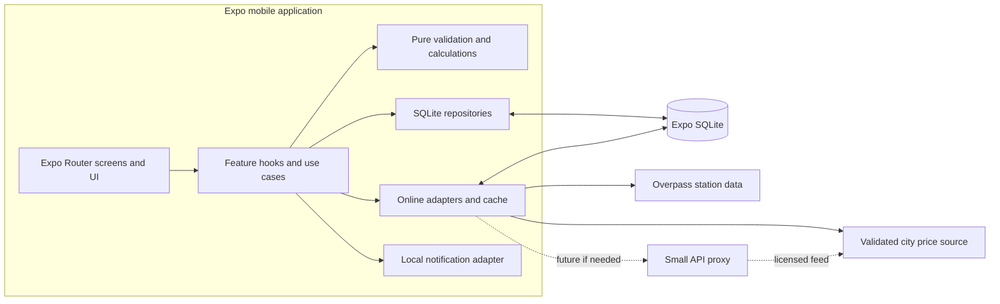
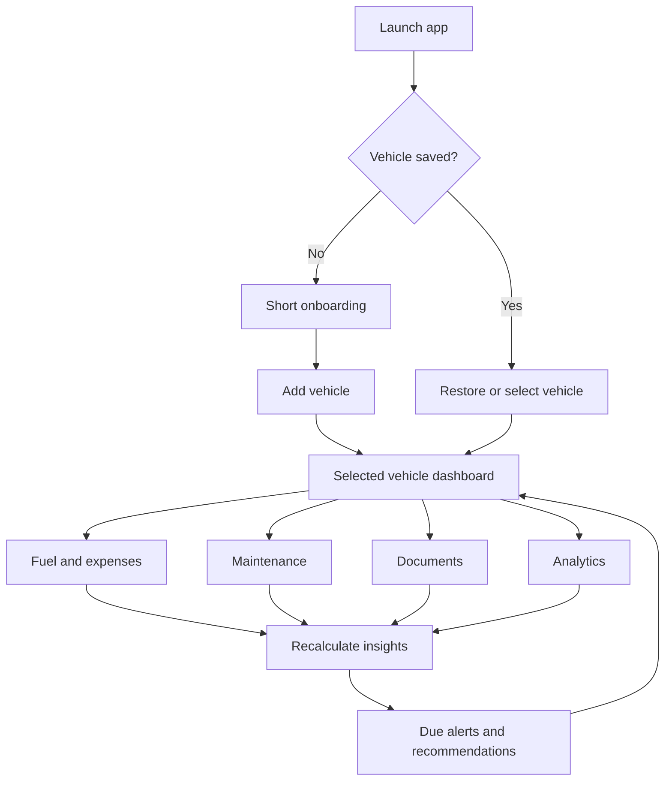
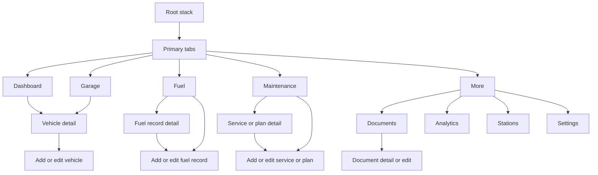
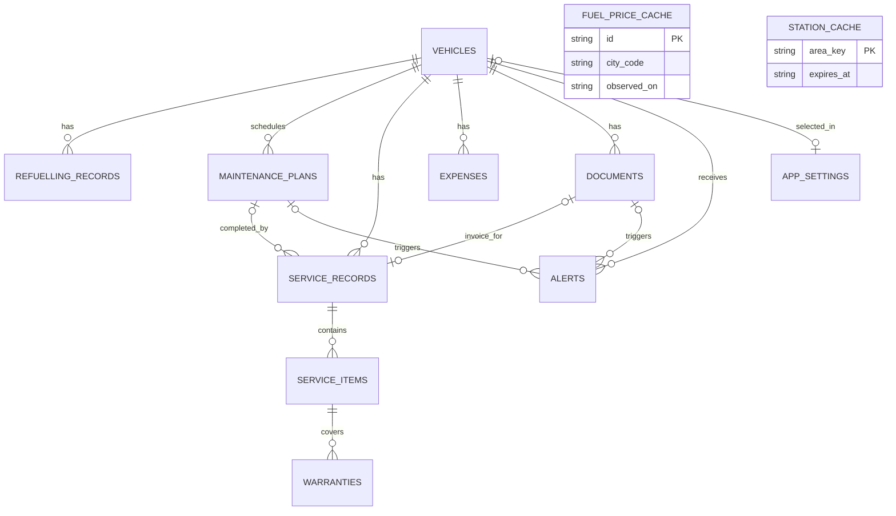
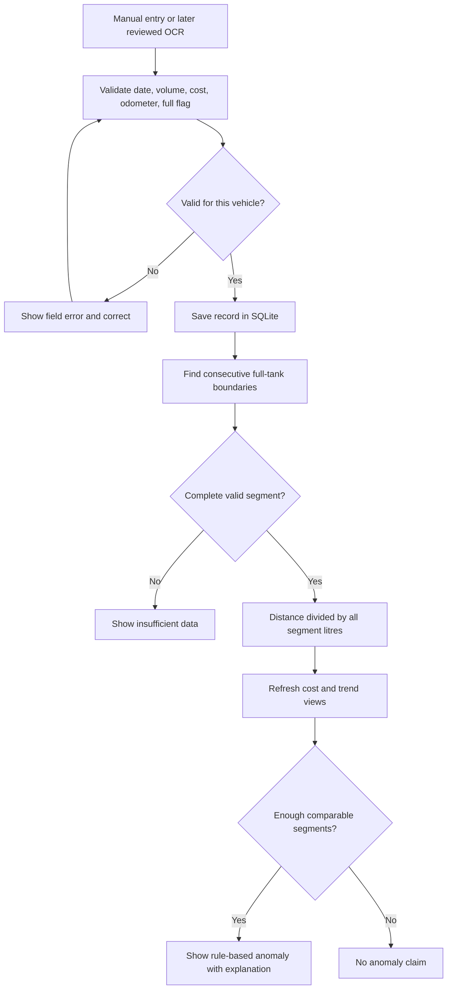
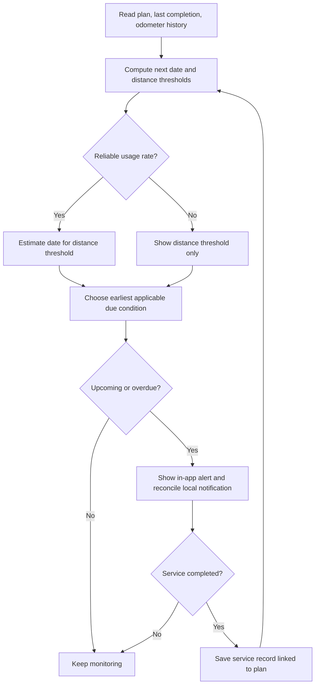
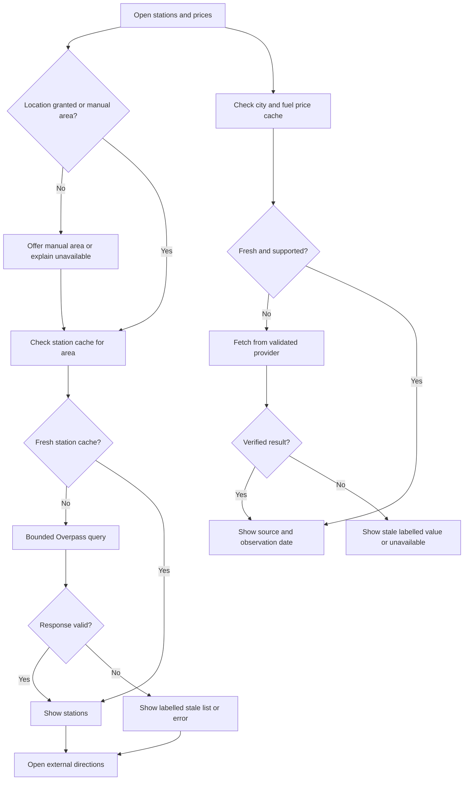
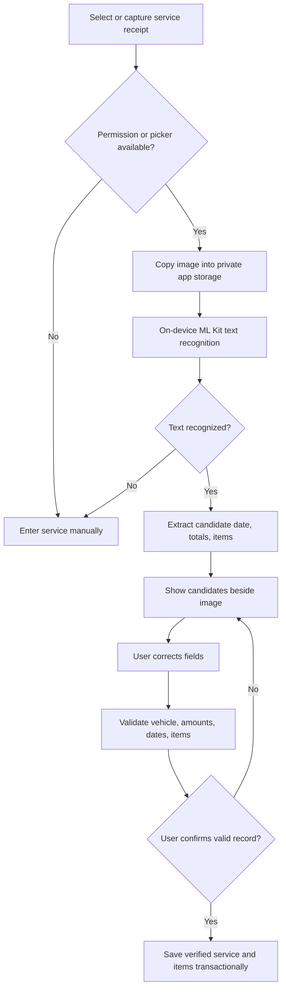

# System flows

> **Original Phase 0 proposal (13 November 2026).** These diagrams include future entities and integrations; they are not an as-built diagram. See the [reconciliation](PHASE0_RECONCILIATION.md).

These diagrams describe the planned implementation. The database and adapter names match [architecture](02_SYSTEM_ARCHITECTURE.md) and [schema](04_DATABASE_DESIGN.md). They are Mermaid blocks intended for GitHub Markdown.

## 1. System architecture

The phone owns core records and calculations. External reads are optional; a future proxy is conditional.

## 2. User journey

Onboarding is a first-run/empty-garage state. Alerts come from recorded facts.

## 3. Navigation flow

The More tab keeps the primary tab bar small. Stack routes own detail and add/edit flows.

## 4. Entity relationships

All owned facts attach to a vehicle. Global settings and caches are not vehicle records.

Settings hold an optional `selected_vehicle_id` foreign key. The caches are independent global lookup data, so no vehicle relationship is implied.

## 5. Fuel intelligence data flow

An edit or backdated insert can change later segments, so derived values are recomputed.

## 6. Maintenance forecasting

Either date or distance reaching its threshold makes a plan due. Distance-to-date prediction is optional and explicitly estimated.

## 7. Fuel station and price integration

Station results and city prices have separate provenance and caches. A station has no assumed live price.

## 8. OCR processing

OCR recognizes text; field extraction is a separate, fallible step. The user confirms every saved field.

